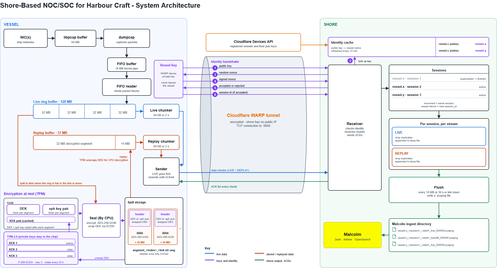

# Maritime-DataBridge

Maritime-DataBridge gets a vessel's network traffic to a security team on shore. Harbour craft run equipment with little security of its own, so their traffic needs to be watched, but they only reach shore over 4G links that keep dropping out.

Maritime-DataBridge captures all of a vessel's traffic and sends it to shore securely. When the link goes down, the vessel keeps recording and stores the traffic encrypted on disk, then sends it once the link is back, so nothing is lost. On shore the traffic is saved as standard pcapng files, labelled with the vessel it came from, for a SOC tool such as Malcolm (Zeek, Arkime and OpenSearch) to analyse.

The link between vessel and shore is built on Cloudflare Zero Trust. Each vessel runs the Cloudflare WARP client, and the shore network is reached through a Cloudflare WARP Connector, so the shore server never has to be exposed to the internet. Cloudflare is also how vessels are identified: every vessel signs in with its WARP device key, and shore checks that key against your organisation's device list.



There are two programs, both written in Rust:

- `noc-vessel` runs on each vessel
- `noc-shore` runs at the shore facility

## How it works

On the vessel, `dumpcap` captures the vessel's networks and hands the packets to `noc-vessel` through a pipe. They go into an in-built buffer in memory and are sent to shore in chunks. Shore confirms every chunk, and anything that is not confirmed is sent again.

If the link goes down, the vessel keeps capturing and saves the unsent data to disk in segments. Each segment is encrypted with AES-256-GCM under its own key, and that key is protected by a master key kept inside the vessel's TPM. When the link comes back, the segments are checked, decrypted and sent. Live data always goes ahead of the backlog.

On shore, each vessel has to prove who it is with its WARP device key, which shore checks against the Cloudflare Zero Trust device list. Shore drops duplicate chunks, keeps live and backfilled data in separate files, and publishes finished pcapng files into the folder Malcolm ingests from.

## Repo layout

| Path | What's in it |
|---|---|
| `common/` | Code shared by both sides: message format, pcapng parsing, the identity handshake, config |
| `vessel/` | The vessel daemon, plus `vessel.example.toml` |
| `shore/` | The shore daemon, plus `shore.example.toml` |
| `deploy/` | `install.sh`, the systemd services, sysctl settings, WARP key staging and `noc-console` |

## Prerequisites

### Cloudflare Zero Trust

Set this up before installing anything:

1. A Cloudflare Zero Trust organisation.
2. **Shore:** a WARP Connector in front of the shore network, so enrolled vessels can reach the shore server's private address.
3. **Each vessel:** the Cloudflare WARP client (`warp-cli`) installed and enrolled in the organisation. The vessel's device name in Cloudflare becomes its name on shore.
4. **The MASQUE tunnel protocol** for the vessels, set in the device profile. With WireGuard, WARP gives the device a different type of key, and the vessel has nothing it can sign in with. Check it on a vessel with:
   ```bash
   warp-cli settings | grep -i "tunnel protocol"
   ```
5. **Split tunnels:** make sure the device profile sends the shore network through WARP. Cloudflare's default list excludes private ranges such as `10.0.0.0/8`, and if the shore's address falls in one of them, the vessel's traffic never reaches the connector.
6. A read-only API token for the Zero Trust Devices API, and your account id. Shore uses them to look up vessels.

### Hosts

Both need Linux with systemd, on x86-64 or aarch64. We used Ubuntu 24.04 and later.

Vessel:
- `dumpcap` (from `wireshark-common`)
- A TPM 2.0 at `/dev/tpmrm0`. The vessel will not start without one.

Shore:
- Malcolm, or anything else that picks up pcapng files from a folder

To build from source you also need Rust (stable), `libtss2-dev` and `pkg-config`.

## Building

```bash
cargo build --release
```

This gives you `target/release/noc-vessel` and `target/release/noc-shore`. Binaries have to match the host's architecture, so build aarch64 on an aarch64 machine.

## Installing

Run the installer on each machine with its role. It builds the code if needed, installs the binaries and services, and checks the host for anything that would stop the daemon from starting.

```bash
sudo deploy/install.sh vessel     # on a vessel
sudo deploy/install.sh shore      # on the shore server
```

It doesn't start anything new. On a fresh host it puts config templates in `/etc/noc` and fills in what it can work out by itself. The rest is up to you:

Vessel, `/etc/noc/vessel.toml`:
- `interfaces`: the networks to capture, e.g. `["eth0"]`
- `shore_addr`: the shore's address and port, e.g. `10.0.0.5:9600`

Shore, `/etc/noc/shore.toml`:
- `cloudflare_account_id`: your Zero Trust account id
- the API token, saved in `/etc/noc/cf_api.token` (readable only by `noc-shore`)

Then start the service:

```bash
sudo systemctl enable --now noc-vessel    # or noc-shore
```

Running the installer again on a host that is already set up updates the binaries, leaves your config alone and restarts whatever was running.

## Watching it run

```bash
sudo noc-console
```

On a vessel it shows the link state, the capture rate, the chunks in flight, how full the buffers are and what is on the spill disk. On shore it lists each vessel with its chunks, duplicates and the files sent to Malcolm. Underneath you get a line per second of activity and events like outages and segments being encrypted or replayed.

## Things worth knowing

- The installer switches the vessel's TCP congestion control to BBR, which copes much better with packet loss on a 4G link than the Linux default (CUBIC).
- Clearing the vessel's TPM deletes the master keys, so any segments still waiting on disk can no longer be decrypted.
- If a vessel's WARP registration changes (for example after `warp-cli registration rotate-keys`), restart `noc-vessel` so it picks up the new key.

